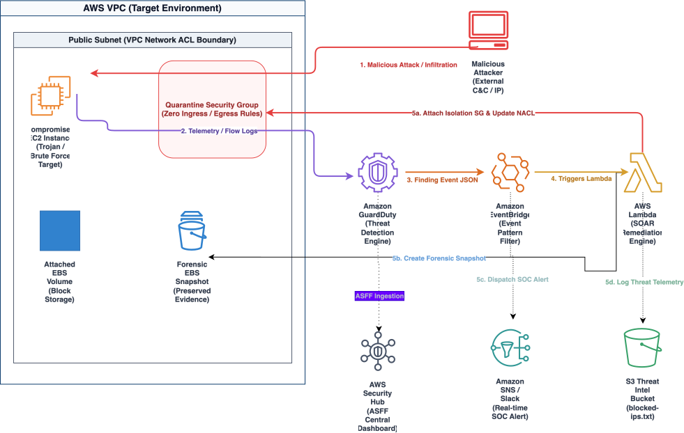

# Automated Cloud Incident Response & Quarantine System (Mini-SOAR)

[](https://aws.amazon.com/certification/certified-security-specialty/)
[](https://www.terraform.io/)
[](https://www.python.org/)

## Executive Summary & Threat Model
In cloud operations, manual threat triage and containment can take hours, allowing attackers to exfiltrate data, perform SSH brute-force attacks, or run cryptocurrency miners. 


This repository implements a serverless, event-driven mini-SOAR (Security Orchestration, Automation, and Response) pipeline on AWS. When Amazon GuardDuty detects suspicious activity on an EC2 workload (such as Trojan C&C communication, brute-force attempts, or data exfiltration), an Amazon EventBridge rule intercepts the finding within seconds. EventBridge triggers an AWS Lambda remediation engine that:

1. **Network Containment -:** Isolates the compromised EC2 instance by attaching a zero-traffic `Quarantine-SG` security group and blocking the offender's IP in the Subnet Network ACL (NACL).
2. **Forensic Evidence Preservation:** Automatically triggers an Amazon EBS Snapshot across all attached volumes for forensic analysis prior to host tampering.
3. **Threat Intel Logging:** Logs the attacker IP into an encrypted Amazon S3 threat intelligence bucket (`blocked-ips.txt`).
4. **Real-time Alerting:** Dispatches immediate alert payloads containing incident metadata and snapshot IDs to Amazon SNS and Slack.

**Key Performance SLA:** Response and containment time is reduced from hours to under 2 minutes from initial detection.

---

## Architecture Diagram

Below is the high-level event flow.



---

## Test it locally using this Step-by-Step Implementation Guide

### Prerequisites & IAM Execution Role
Provision the IAM Execution Role named **`lambda_soar_execution_role`** to grant the remediation engine least-privilege permissions across EC2, S3, SNS, and CloudWatch Logs.

**Resource Name:** 

`lambda_soar_execution_role`

**Key Actions Permitted:** 
  1. `ec2:ModifyInstanceAttribute`, 
  2. `ec2:CreateSnapshot`, 
  3. `ec2:CreateNetworkAclEntry`, 
  4. `s3:PutObject`, 
  5. `sns:Publish`

**Source Reference File:** [`terraform/main.tf`](./terraform/main.tf)

---

### Step 1: Provision the Quarantine Security Group
Create a dedicated zero-ingress, zero-egress Security Group to immediately isolate compromised hosts.


**Resource Name:** `Quarantine-SG`

**CLI Command Brief**

```bash
    aws ec2 create-security-group --group-name "Quarantine-SG" --description "Zero-traffic isolation SG" --vpc-id "vpc-xxxxxxxx"
```
**Configuration:** Remove all inbound and outbound default rules so all network traffic is dropped.

---

### Step 2: Configure Amazon EventBridge Filter Pattern
Deploy an EventBridge rule that evaluates incoming GuardDuty finding payloads in real-time and routes medium-to-high severity EC2 threats (`Severity >= 4.0`) to the Lambda function.


**Resource Name:** `GuardDuty-SOAR-Trigger`


1. **Filter Criteria:** 


   * `detail-type`:`"GuardDuty Finding"`, 
   * `severity`: `>= 4.0`, 
   * `resourceType`:`"Instance"`
2. **Target Finding Types:** 
* `UnauthorizedAccess:EC2/SSHBruteForce`, 
* `Trojan:EC2/BlackholeTraffic`, 
* `Impact:EC2/DataExfiltration`

**Source Reference File:** [`terraform/main.tf`](./terraform/main.tf)

---

### Step 3: Deploy the AWS Lambda SOAR Handler
Deploy the serverless remediation function written in Python 3.11 using Boto3.


**Resource Name:** `GuardDuty-SOAR-Remediator`

**Core Remediation Steps:**


1. Extract `InstanceId` and `RemoteIpAddress` from the GuardDuty event payload.
2. Swap instance Security Groups with `ISOLATION_SG_ID` (`Quarantine-SG`).
3. Call `ec2.create_snapshot()` on all attached EBS volumes for forensic retention.
4. Append the attacker IP to `s3://your-threat-intel-bucket/blocked-ips.txt`.
5. Publish incident summary to Amazon SNS (`mini-soar-alerts`) and Slack.
   
**Source Reference File:** [`src/lambda_function.py`](./src/lambda_function.py)

---

## Simulation & Validation Playbook

Validate your automated incident response workflow using the AWS CLI:

  1. **Trigger Sample GuardDuty Findings:**

   ```bash
   aws guardduty create-sample-findings \
     --detector-id $(aws guardduty list-detectors --query 'DetectorIds[0]' --output text) \
     --finding-types "UnauthorizedAccess:EC2/SSHBruteForce" "CryptoCurrency:EC2/BitcoinTool.B"
   ```
   2. **Verify Network Isolation:** Inspect the EC2 instance in the AWS Console to confirm its Security Group was automatically switched to `Quarantine-SG`.
   3. **Verify Forensic Snapshot:** Check EC2 Snapshots to confirm new volume snapshots were created with the description `"Forensic Snapshot for i-xxx..."`.
   4. **Verify Threat Intel Logging:** Confirm the attacker IP is logged inside `s3://your-threat-intel-bucket/blocked-ips.txt`.
   5. **Verify Incident Alert:** Check your SNS subscriber email or Slack channel for the real-time notification payload. 

---

## References & AWS Documentation used to assist in building the project

  - [Amazon GuardDuty Finding Types & EventBridge Integration](https://docs.aws.amazon.com/guardduty/latest/ug/guardduty_findings_cloudwatch.html)
  - [AWS Solutions: Automated Security Response on AWS Guide](https://aws.amazon.com/solutions/implementations/automated-security-response-on-aws/)
  - [Amazon EventBridge Event Patterns & Rule Filtering](https://docs.aws.amazon.com/eventbridge/latest/userguide/eb-event-patterns.html)
  - [AWS Lambda Developer Guide & Boto3 EC2 Automation](https://docs.aws.amazon.com/lambda/latest/dg/welcome.html)
  - [Amazon EC2 Security Groups & Network Isolation Controls](https://docs.aws.amazon.com/AWSEC2/latest/UserGuide/ec2-security-groups.html)
  - [Amazon EBS Snapshots & Forensic Evidence Preservation](https://docs.aws.amazon.com/AWSEC2/latest/UserGuide/AmazonEBS.html)
  - [AWS Security Hub Finding Format (ASFF) Specification](https://docs.aws.amazon.com/securityhub/latest/userguide/securityhub-findings-format.html)